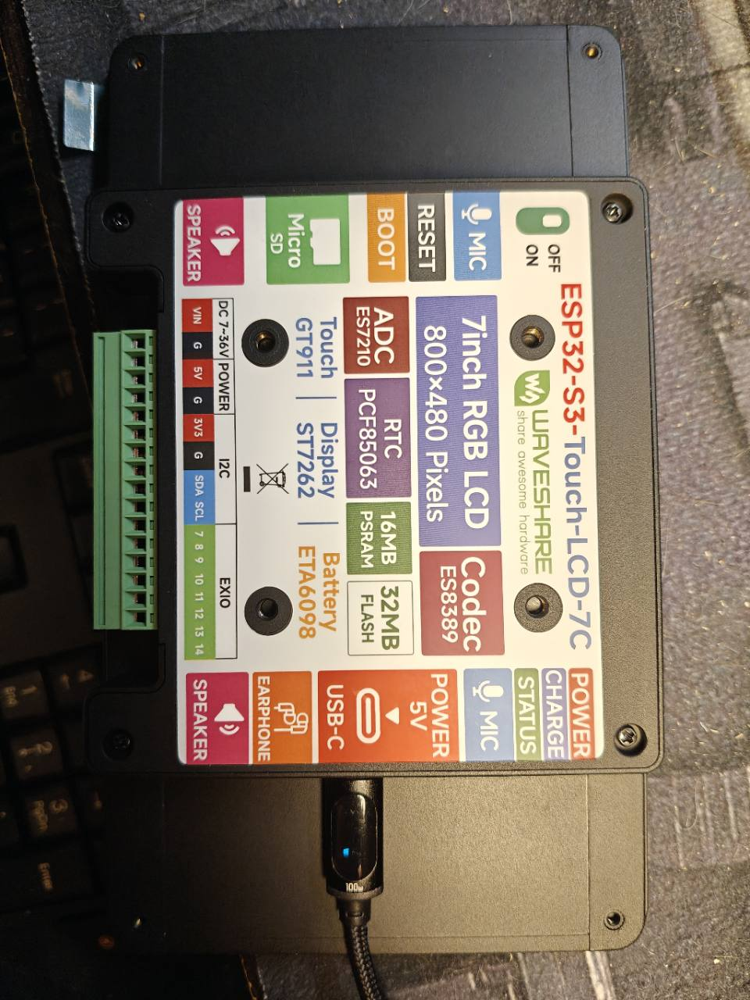

# Waveshare ESP32-S3-Touch-LCD-7C · Smart Home Hub & Voice Satellite

[](https://esphome.io)
[](https://www.waveshare.com)
[]()
[](LICENSE)

A production-grade, 7-inch **Smart Home Touch Hub and Voice Assistant Endpoint** for **Home Assistant**, powered by the **Waveshare ESP32-S3-Touch-LCD-7C** development board.



> [!NOTE]
> **Video Demonstration:** A live video demo showcasing responsive touchscreen navigation, internet radio playback, and direct remote control of the **Spider** Hi-Fi audio player will be published here upon final field recording.

---

## Highlights

* **7.0" Capacitive Touch Display (800x480):** High-resolution color dashboard powered by LVGL and ESPHome.
* **Direct Spider Audio Controller:** Live track metadata, play/pause transport, volume sliders, and radio presets for the room's **Spider** audio streamer via Music Assistant.
* **Acoustic Echo Cancellation (AEC):** Hardware ES7210 dual-microphone processor with custom ring-buffer driver stack (`components/esp_audio_stack`).
* **Dual-Layer Battery Protection:**
  * **Software Safety:** Monitored cell voltage **≤ 3.20 V** triggers an immediate graceful deep-sleep shutdown.
  * **Hardware BMS 1S (3A):** Protects a 2x 18650 parallel pack (1S2P, ~4400 mAh) against short circuits, overcharging (> 4.25V), and deep cell discharge.
  * **Field Endurance:** Delivered **10 hours 35 minutes** of continuous active touchscreen operation on battery alone.
* **Power Efficiency:** Consumes only **~1.5 W** under typical wall power operation.
* **Home Automation Control:** Native tabs for living areas, room scenes, digital flip-clock, and weather updates.

---

## Ecosystem Integration: 7C + Spider + RLCD

```text
       +----------------------------------------------------+
       |              Home Assistant Server                 |
       +----------------------------------------------------+
              ^                         ^            ^
              |                         |            |
       [Assist Pipeline]           [Dashboard]  [Music Assistant]
              |                         |            |
              v                         v            v
     +-----------------+       +----------------+   +-------------------+
     |   RLCD 4.2"     |       |  Touch LCD 7C  |   |  Spider Streamer  |
     | Voice Satellite |       |  (This Repo)   |-->|  ESP32-S3 + DAC   |
     +-----------------+       +----------------+   +-------------------+
```

1. **Touch LCD 7C (This Repository):** Central bedside or desk touch hub providing complete room control and tactile media player navigation.
2. **Spider Audio Streamer:** Dedicated network audio streamer (ESP32-S3 + PCM5102A Hi-Fi DAC). The 7C panel acts as Spider's physical remote screen, selecting radio streams and showing live track details.
3. **RLCD 4.2" Satellite:** Silent, non-glare reflective display satellite for discrete voice assistance in other rooms.

---

## Repository Structure

```text
├── components/
│   └── esp_audio_stack/                 # Custom ESPHome audio driver for ES7210 AEC & I2S
├── esphome/
│   ├── esp32_s3_touch_lcd_7c.yaml       # Main production firmware configuration
│   └── secrets.yaml.example             # Network credentials template
├── hardware/
│   ├── README.md                        # BMS 1S wiring, power terminals, and battery details
│   └── *.jpg                            # Board layout, connectors, and speakers photos
├── ui/
│   ├── README.md                        # Screen tab breakdown (DOM, AUDIO/SPIDER, OŚWIETLENIE)
│   └── *.svg                            # Vector source designs for all dashboard screens
├── firmware/
│   └── esp32_s3_touch_lcd_7c_factory.bin # Pre-compiled flashable factory binary
└── README.md
```

---

## 🇵🇱 Dokumentacja i opis projektu (PL)

### Główne cechy
* **Dotykowy ekran 7.0" (800×480):** pojemnościowy panel dotykowy pracujący pod kontrolą biblioteki LVGL w ESPHome, wyświetlający zegar klapkowy, aktualną pogodę, oświetlenie i strefę audio.
* **Ekranowy pilot odtwarzacza Spider:** dedykowany widok `AUDIO (SPIDER)` umożliwia bezpośrednie sterowanie domowym odtwarzaczem muzycznym **Spider** (Music Assistant): wybór stacji radiowych, zmiana utworów, podgląd wykonawcy i tytułu oraz płynna regulacja głośności.
* **Tor audio z kasowaniem echa (AEC):** sprzętowy procesor ES7210 z dwoma mikrofonami analogowymi i dedykowany komponent `esp_audio_stack`, zapobiegający kolizjom buforów I2S podczas jednoczesnego nasłuchu i odtwarzania.
* **Podwójna ochrona zasilania (BMS 1S + Deep Sleep 3.2V):**
  * **Ochrona programowa:** przy spadku napięcia do **≤ 3,20 V** ESPHome natychmiast wyłącza podświetlenie, przetwornicę LCD i usypia procesor (deep sleep), chroniąc ogniwa przed degradacją.
  * **Ochrona sprzętowa:** moduł BMS 1S (3A) zabezpiecza koszyk 2x 18650 (układ 1S2P, ~4400 mAh) przed zwarciem i przeładowaniem.
  * **Wynik testu poligonowego:** panel przepracował nieprzerwanie **10 godzin i 35 minut** na zasilaniu bateryjnym przy normalnym, aktywnym użytkowaniu. Średni pobór mocy z sieci to zaledwie **~1,5 W**.

---

## Quick Start

### 1. Wi-Fi Configuration
Copy `esphome/secrets.yaml.example` to `esphome/secrets.yaml`:
```bash
cp esphome/secrets.yaml.example esphome/secrets.yaml
```
Enter your home network credentials.

### 2. Compile & Upload
```bash
esphome run esphome/esp32_s3_touch_lcd_7c.yaml
```

---

## License & Attribution

Designed and maintained by **hookmt** ([GitHub](https://github.com/hookmt)).
Open-source under the MIT License.
