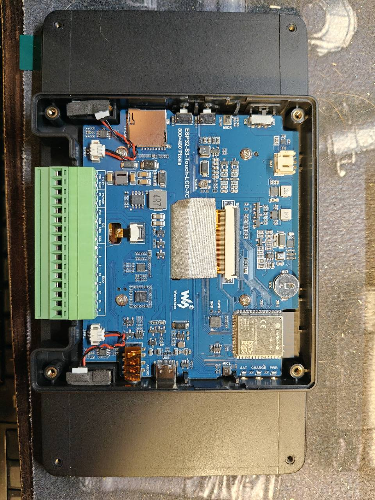
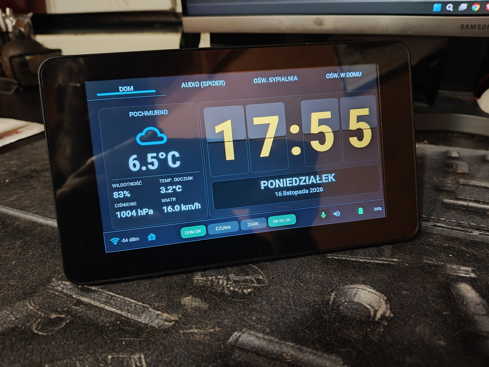
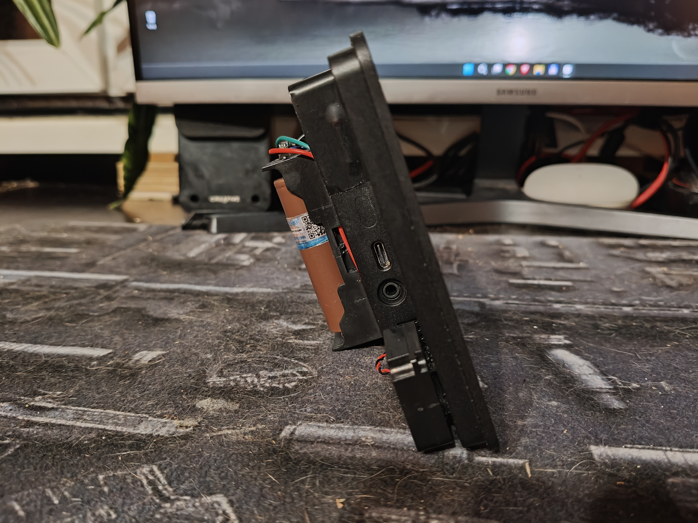
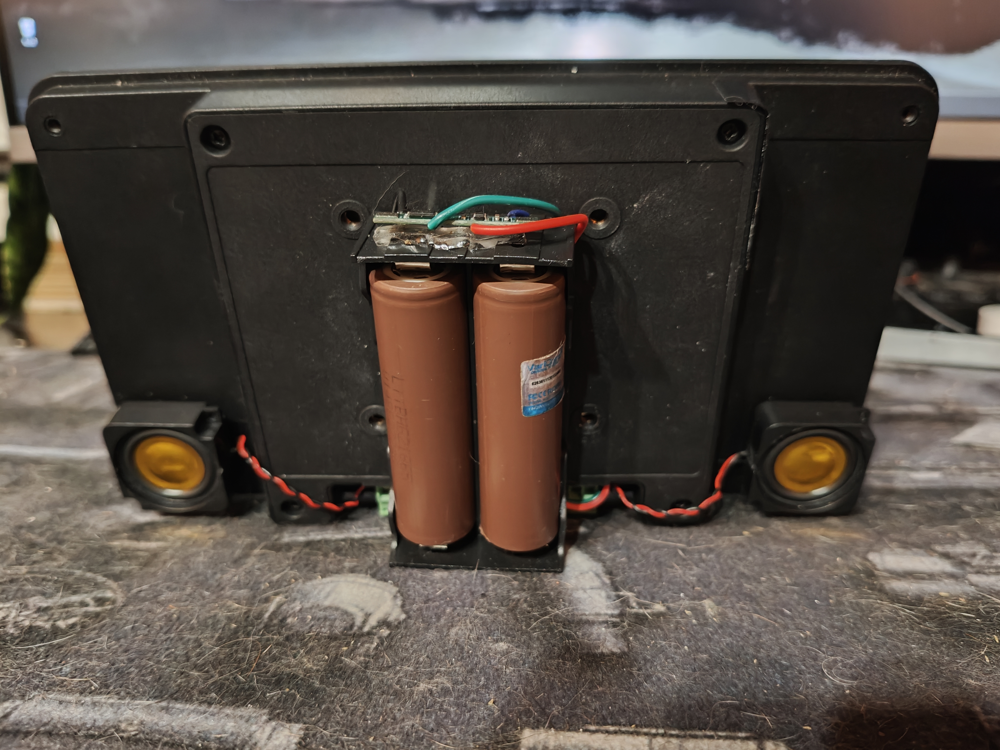
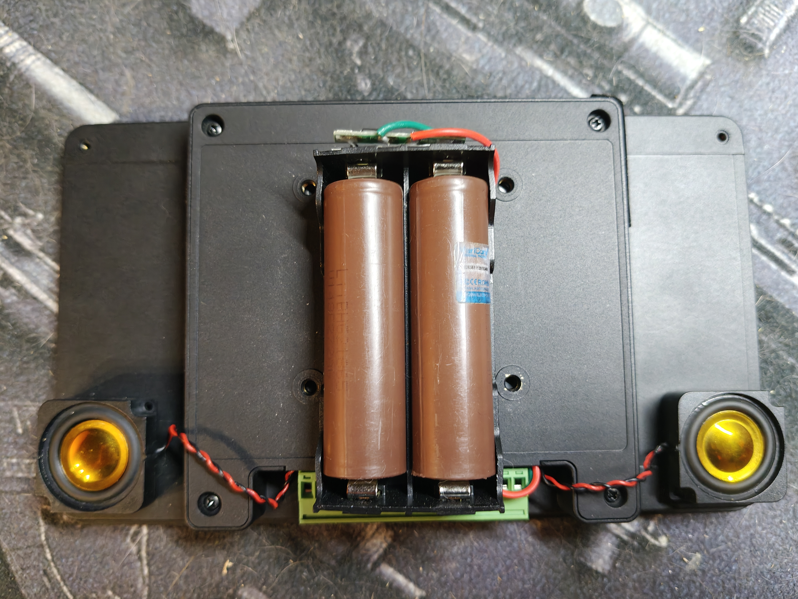

# Hardware & Power Management Guide · Waveshare ESP32-S3-Touch-LCD-7C

This document details the hardware layout, audio peripherals, and the **dual-layer battery & power protection architecture** developed for the Waveshare ESP32-S3-Touch-LCD-7C smart home panel.

---

## 1. Board Layout & Connectors

The Waveshare 7C board provides an industrial-grade interface layout:



### Key On-board Interfaces
* **Power Terminal Block (Green Screw Terminals):**
  * `7-36V VIN / GND`: Wide-range industrial DC input with onboard step-down regulation.
  * `5V / GND`: Regulated 5V DC input.
  * `3V3 / GND` & `SDA / SCL`: Auxiliary I2C expansion.
* **USB-C Port:** Flashing and standard 5V USB power.
* **BAT (White 2-Pin JST-PH Connector):** Direct connection for 1S (3.7V - 4.2V) Li-ion battery pack.
* **Audio Out (`SPKR`, `SPKL`):** Dual 2-pin JST speaker outputs driven by the onboard ES8311 codec and class-D amplifier.
* **Microphones (`MICR`, `MICL`):** Dual analog capsules connected to the ES7210 AEC codec.
* **Controls:** Hardware power switch (`ON/OFF`), tactile `BOOT` and `RESET` buttons.

---

## 2. Dual-Layer Battery Protection Architecture

Driving an 800x480 7-inch capacitive touchscreen alongside Wi-Fi and audio DSP requires reliable battery management. A two-layer protection strategy prevents cell degradation or uncontrolled brownouts:

```text
  [ 2x 18650 Cells (1S2P, ~4400 mAh) ]
                 |
                 v
   +---------------------------+
   |   Layer 2: Hardware BMS   |  <-- BMS 1S (3A): Short-circuit & 2.5V emergency cutoff
   +---------------------------+
                 |
                 v  (JST-PH "BAT" connector)
   +---------------------------+
   |  Layer 1: Software Safety |  <-- ESPHome monitoring (voltage <= 3.2V)
   +---------------------------+      -> Shuts down backlight, LCD VDD, and enters Deep Sleep
                 |
                 v
   [ ESP32-S3 & System Load ]
```

### Layer 1: Software Voltage Guard (ESPHome)
* **Threshold:** Monitored cell voltage **≤ 3.20 V**.
* **Action:** Automatically stops Voice Assistant tasks, turns off the LCD backlight (`EXIO2`), disables LCD logic power (`EXIO5`), mutes audio power amplifiers, and transitions the ESP32-S3 into indefinite deep sleep.
* **Recovery:** Reconnect DC or USB power and press `RESET`.

### Layer 2: Hardware BMS 1S Protection
* **Module:** 1S 3A Li-ion protection board wired directly to the battery pack.
* **Protection:** Guards against overcharge (> 4.25 V), severe over-discharge (< 2.54 V cutoff), and physical short circuits.

---

## 3. Battery Endurance Field Test (10.5 Hours Active)

In real-world testing with two parallel 18650 cells (1S2P configuration, ~4400 mAh nominal capacity):
* **Initial State:** 4.20 V (100%).
* **Active Load:** Continuous display active, periodic capacitive touch interaction, ambient light adjustments, and ongoing network telemetry with Home Assistant.
* **Total Runtime:** **10 hours 35 minutes** before gracefully triggering the software 3.2V deep-sleep shutdown.
* **Average Power Consumption:** ~1.5 W from wall power during typical operation.

---

## 4. Mechanical Mounting & Speakers Assembly

The 7C panel is assembled with a clean, functional desktop setup:
* **Kickstand Battery Holder:** The dual 18650 battery holder is mounted centrally on the rear housing, doubling as a stable angled desktop kickstand.
* **BMS 1S Circuit Board:** Solder-mounted at the top of the battery holder with short wiring to the internal `BAT` JST connector.
* **Stereo Speakers on Nano Tape:** High-efficiency micro speakers with golden cones are mounted on the bottom wings of the rear chassis using heavy-duty transparent acrylic nano tape, decoupling acoustic vibrations from the display glass while providing clear room audio.






