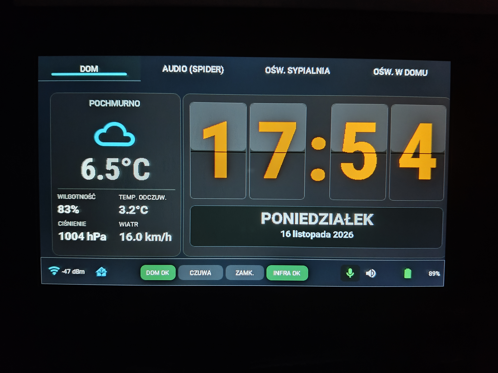
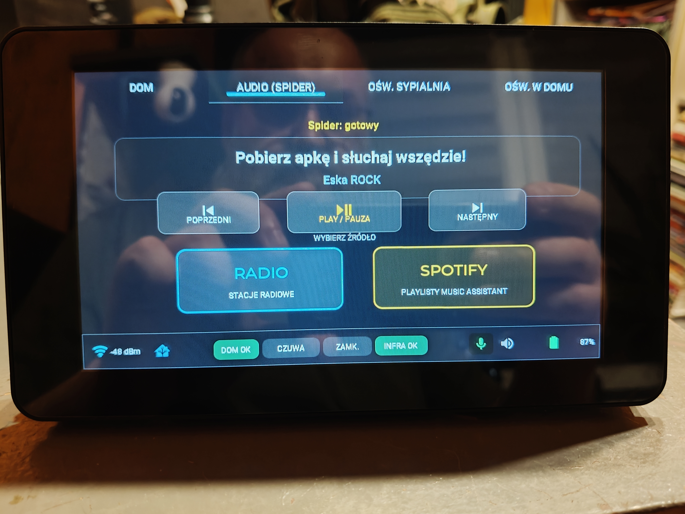
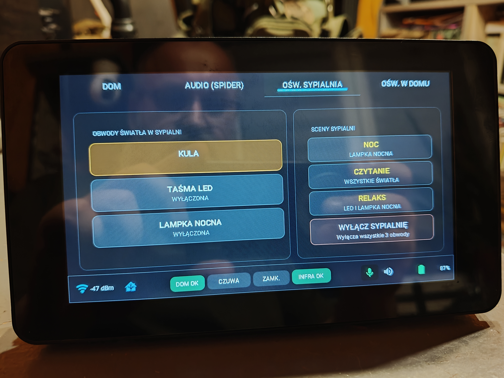
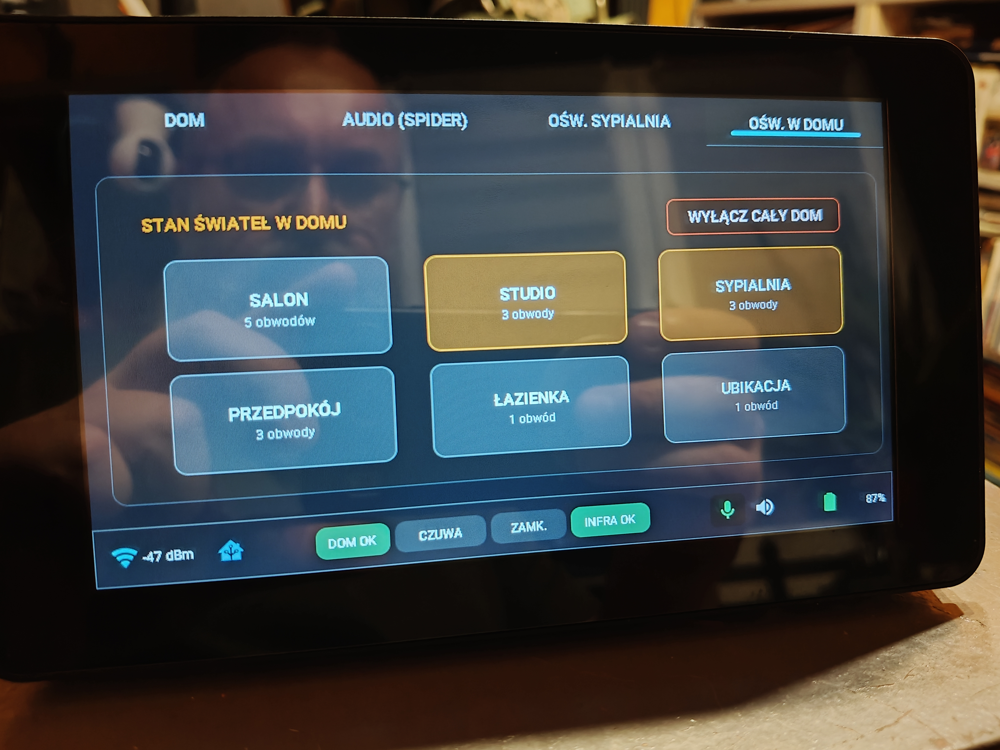

# User Interface Design & Screen Layouts

The **Waveshare ESP32-S3-Touch-LCD-7C** panel features a multi-tab LVGL interface rendered at native 800x480 resolution.

---

## Screen Tabs & Functions

### 1. Tab: DOM (Home Dashboard)
* **Digital Flip Clock:** Large high-contrast digits with seconds and live date indicators.
* **Weather Widget:** Live weather icons, outdoor temperature, and humidity synchronized with Home Assistant.
* **System Bar:** Wi-Fi RSSI signal meter, Home Assistant connection dot, battery voltage indicator, and master Assist trigger button.
* *Source SVG:* [`start.svg`](start.svg)

### 2. Tab: AUDIO (SPIDER Streamer Control)
* **Direct Music Assistant Integration:** Controls the room's dedicated **Spider** Hi-Fi audio streamer (`media_player.spider_one_audio_receiver_2`).
* **Playback Transport:** Play, pause, skip forward, and volume sliders.
* **Track Metadata:** Real-time artist name and track title (text metadata, intentionally without album art decoding to conserve RAM and LVGL render cycles).
* **Radio Station Quick Presets:** One-touch playback of favorite internet radio stations without opening mobile apps.
* *Source SVG:* [`spider.svg`](spider.svg)

### 3. Tab: OŚWIETLENIE (Lighting & Scenes)
* **Room Scenes:** Preset buttons for reading, evening relaxation, and master room shutoff.
* **Whole-House Status:** Global overview of all room lights with a single "Turn off all house lights" safety button.
* *Source SVGs:* [`sypialnia.svg`](sypialnia.svg) and [`oswietlenie_dom.svg`](oswietlenie_dom.svg)

